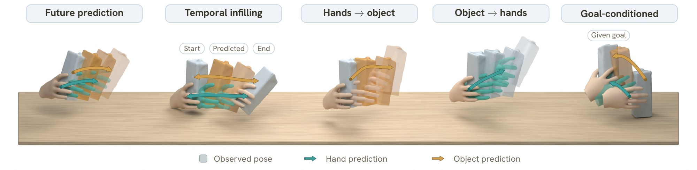
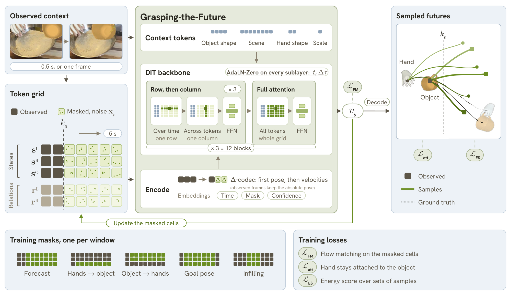
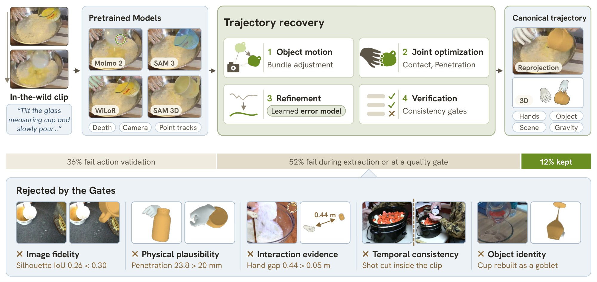

# Grasping the Future: Joint 3D Hand–Object Forecasting from Internet Videos

[](https://arxiv.org/abs/2611.12879)
[](https://grasping-the-future.github.io)
[](https://huggingface.co/raivn/grasping-the-future)



Grasping the Future (GTF) is a generative model of 3D hand–object motion: both MANO hands (wrist pose and finger
articulation) and the 6-DoF pose of the object they manipulate. One model trained with flow matching on masked
spatiotemporal completion covers seven tasks: forecasting, hands from object motion, object from hand motion, temporal
infilling, and three goal-conditioned variants. Its training data combines eight motion-capture datasets with
trajectories that our extraction pipeline recovers from internet videos (Action100M).

<details>
<summary><b>Model overview</b></summary>



An interaction is a grid of tokens: one column per frame, rows for the states of the two hands and the object and for
the hand–object relations. Observed cells are given and the others start as noise; a transformer predicts the flow
velocity of the noise cells, conditioned on the object shape, the scene, the hand shapes and the scale, and ten Euler
steps decode a sample. Each training window draws its own observation mask, so the same model learns every task.

</details>

This repository contains:

- **the model**, its training and its evaluation on the paper's benchmark (`gtf/model`, `gtf/data`, `gtf/training`, `gtf/eval`);
- **inference** on your own clips (`gtf/predict.py`);
- **the extraction pipeline** that turns an RGB clip into hand and object trajectories (`gtf/extraction`);
- **the dataset loaders** that build the training corpus from the motion-capture datasets (`gtf/datasets`);
- **the robot retargeting experiment** of the paper (`robotics/`).

## Installation

Tested on Linux with Python 3.11, PyTorch 2.10 and CUDA 12.9 on H100 and B300 GPUs.

```bash
git clone https://github.com/RustinS/grasping-the-future.git
cd grasping-the-future
uv venv --python 3.11 .venv && source .venv/bin/activate
uv pip install torch torchvision --index-url https://download.pytorch.org/whl/cu129
uv pip install -e .                      # model, training and evaluation
uv pip install -e ".[corpus]"            # + inference on new data and building a training corpus
uv pip install -e ".[extraction]"        # + extracting trajectories from video
bash third-party/setup.sh model          # or: corpus, extraction, all (see third-party/README.md)
```

**MANO.** Register at [mano.is.tue.mpg.de](https://mano.is.tue.mpg.de), download the model files and place
`MANO_RIGHT.pkl` (and `MANO_LEFT.pkl`) in `third-party/mano/`, or point `MANO_DIR` at their folder.

<details>
<summary>Notes on dependencies</summary>

- `torch-scatter` and `spconv` need wheels that match your PyTorch and CUDA versions.
- PyTorch3D (corpus) installs from source: `uv pip install --no-build-isolation "git+https://github.com/facebookresearch/pytorch3d.git"`.
- The extraction pipeline and the scene features use models whose licenses must be accepted on Hugging Face before
  downloading (SAM 3D Objects, DINOv3, SAM 3); log in with `hf auth login`.

</details>

## Model weights

```bash
hf download raivn/grasping-the-future gtf_main.ckpt --local-dir checkpoints
```

`checkpoints/gtf_main.ckpt` is the paper's main model (116M parameters) in one file: its weights, its configuration, the
normalization statistics it was trained with and the PCA basis of its DINOv3 scene features.

## Inference on new data

`gtf.predict` samples trajectories for one task on your own segments: extract them from video with the pipeline below,
or write them in the format of `docs/data.md` ("Your own segments"). On its first run it builds the model inputs next to
the segments (a manifest, per-frame scene caches with MoGe-2 depth and DINOv3 features, and Uni3D object embeddings;
this needs `bash third-party/setup.sh corpus`).

```bash
python -m gtf.predict --segments my_segments --out predictions --task future_prediction    # the released model, checkpoints/gtf_main.ckpt
python -m gtf.predict ... --segment NAME --start 2.0 --task object_to_hand eval.n_samples=5
```

Windows are five seconds long (every 2.5 s, or from each `--start`); `future_prediction` observes the first half
second and predicts the rest. Each window gives `predictions/<segment>/<task>_<frame>.npz`: N sampled trajectories with
the hand and object fields of `canonical.npz` in the segment's camera frame, the observed and present masks, and the
MANO shapes and object mesh needed to pose them. Observed frames hold the input.

## Extraction from video



`gtf/extraction` reconstructs two MANO hands and one rigid object from an RGB clip: action validation (Molmo2), shot
cuts, hands (WiLoR), object pointing (Molmo2), video masks (SAM 3), object reconstruction and pose (SAM 3D Objects,
CoTracker, MegaSaM, MoGe), joint optimization of hands and object, temporal refinement, export of the trajectory and 21
quality gates. Two chains share the stages: `production`, the recipe that built the paper's training data and
benchmark, and `upgraded`, with improved hand placement, object rotation and smoothness.

<details>
<summary>Running the pipeline</summary>

```bash
python -m gtf.extraction.action100m.pipeline --video-dir /data/videos                 # every Action100M segment (object discovery)
python -m gtf.extraction.action100m.pipeline --object cup --limit 10 --video-dir /data/videos
ACTION100M_RESULTS_DIR=$PWD/results_upgraded python -m gtf.extraction.action100m.pipeline --segment NAME --chain upgraded
bash scripts/run_split_extraction.sh SEGMENTS.txt 4 0,1,2,3 24                         # one node at scale
```

The Action100M annotations (parquet files) go in `datasets/action100m/`; the source videos are read from `--video-dir`,
one file per YouTube id. `docs/extraction.md` covers the stages, the chains, the outputs and the settings.

</details>

## Training

The defaults in `gtf/config.py` are the main model; `configs/main.yaml` adds the paper's topology (2 nodes x 8 GPUs,
32 windows per GPU, 40K steps) and the corpus paths.

<details>
<summary>Building the training corpus</summary>

The model reads segments of a **corpus**: per-segment trajectories (`results/<segment>/canonical/canonical.npz`), their
scene caches, a manifest, a Uni3D object-embedding cache and normalization statistics. `docs/data.md` describes the
format and the conventions.

**Motion capture.** Download DexYCB, HOT3D, TACO, OakInk2, HO-3D, H2O, HO-Cap and SHOW3D under their licenses into
`datasets/<name>/` (each loader documents its expected layout and downloads what it can), then build the corpus:

```bash
bash scripts/build_corpus.sh configs/main.yaml            # ingest, interaction windows, manifest, scene caches, Uni3D, statistics
bash scripts/build_corpus.sh configs/main.yaml scene      # one stage
```

**Internet video.** Action100M trajectories come from the extraction pipeline run into the same `results/` folder
before the manifest stage. We do not redistribute the videos or the extracted trajectories.

To fine-tune the released model, write its statistics and PCA basis to `datasets/` before building the corpus (the
build keeps an existing basis): `python -m gtf.training.export_checkpoint unpack checkpoints/gtf_main.ckpt --out datasets`.

</details>

<details>
<summary>Training and exporting a model</summary>

```bash
python -m gtf.training.train --config configs/main.yaml                                          # one process per GPU (torchrun on several nodes)
python -m gtf.training.train --config configs/main.yaml trainer.devices=1 trainer.num_nodes=1    # one GPU
```

Checkpoints go to `checkpoints/<run>/`; an interrupted run resumes from its last complete checkpoint.
`python -m gtf.training.export_checkpoint export checkpoints/<run>/last.ckpt checkpoints/<model>.ckpt` packs the
weights, the configuration, the statistics and the PCA basis into one file like the released model.

</details>

## Evaluation

The paper's benchmark has 256 motion-capture and 75 internet-video validation windows of five seconds (`benchmark/`)
and seven tasks.

<details>
<summary>Running the benchmark</summary>

`run` samples 20 trajectories per window and task (10 Euler steps, seed 42); `tables` scores Tables 1 and 2 (one
sample, best of 20, energy score, reference inside the samples; ADE and FDE for forecasting).

```bash
for pop in mocap action100m; do
  python -m gtf.eval.benchmark run --checkpoint checkpoints/gtf_main.ckpt --population $pop --out results/benchmark
done
# Table 2 scores the motion-capture windows on scene caches built from estimated instead of sensor depth
python -m gtf.datasets.scene.preprocess --depth estimated --cache-root DIR
python -m gtf.datasets.build_manifest --scene-cache-root DIR --output DIR/canonical_manifest.json
python -m gtf.eval.benchmark run --checkpoint checkpoints/gtf_main.ckpt --population mocap --tasks future_prediction \
  --manifest DIR/canonical_manifest.json --out results/benchmark_estimated_depth
python -m gtf.eval.benchmark tables results/benchmark --table2-mocap-run results/benchmark_estimated_depth
```

The internet-video windows need the 75 benchmark segments extracted with the production chain. `--forecasts` makes
`run` also write `<population>/future_prediction.pt`, the input of the robot retargeting.
`python -m gtf.eval.run_eval` evaluates a checkpoint on a whole validation split.

</details>

## Robot retargeting

`robotics/` retargets forecasts to simulated XHand robot hands with SPIDER and reproduces the paper's success rates;
it has its own environment. See `robotics/README.md`.

<details>
<summary><b>Repository layout</b></summary>

| Path | Content |
|---|---|
| `gtf/model/` | Representation (`repr/`), transformer and conditioning (`arch/`), flow matching, sampling and losses (`flow/`) |
| `gtf/data/` | Training dataset, sampler, augmentation, normalization statistics, Uni3D embedding cache |
| `gtf/training/`, `gtf/eval/` | Trainer, its entry point and checkpoint export; evaluation, metrics and the benchmark |
| `gtf/predict.py` | Inference on new segments |
| `gtf/extraction/` | The extraction stages (one folder per stage group), the two chains (`chains.py`), the Action100M orchestrator |
| `gtf/datasets/` | One loader per motion-capture dataset, interaction windows, the manifest, scene caches (`scene/`) |
| `gtf/config.py`, `configs/` | Configuration defaults (the main model) and the run configs |
| `benchmark/` | The benchmark windows |
| `scripts/` | Corpus build and single-node extraction drivers |
| `third-party/` | Setup script and patches for the external code |
| `robotics/` | Robot retargeting |
| `tests/` | Unit tests (`pytest tests`; the hand tests need MANO) |

</details>

## License and acknowledgments

The code is released for non-commercial research use. The model weights derive from the datasets listed above and from
internet videos; use them under the terms of those datasets. External code fetched by `third-party/setup.sh` and
`robotics/third_party.sh` keeps its own license, several of which are non-commercial (WiLoR, SPIDER, SAM 3D Objects,
DINOv3), and MANO requires its own registration.

The pipeline builds on WiLoR, Molmo2, SAM 3, SAM 3D Objects, CoTracker, MegaSaM, MoGe, Kaolin and manopth; the model on
LitePT, Uni3D and DINOv3; the retargeting on SPIDER and MuJoCo.

## Citation

```bibtex
@article{soraki2026grasping,
  title={Grasping the Future: Joint 3D Hand-Object Forecasting From Internet Videos},
  author={Soraki, Rustin and Wallingford, Matthew and Aby, Ryan and Chee, Brandon and Ren, Jason and Farhadi, Ali and Bharadhwaj, Homanga and Mottaghi, Roozbeh},
  journal={arXiv preprint arXiv:2611.12879},
  year={2026}
}
```
